<div align="center">

# ⚡ Fio Certo

### Dimensionamento elétrico residencial completo, com base na ABNT NBR 5410:2004, que explica cada número

Da planta do cômodo ao memorial técnico em PDF. Cada fórmula aparece com os valores substituídos e a cláusula da norma ao lado.
Roda inteiro no navegador, sem cadastro e sem servidor.

[](https://github.com/rlasmar-uff/fio-certo/actions/workflows/publicar.yml)


### **[▶ Abrir o Fio Certo](https://rlasmar-uff.github.io/fio-certo/)**


</div>

> Ferramenta de apoio ao estudo e ao pré-dimensionamento, feita como projeto de extensão universitária
> (UFF · TEE00192, Circuitos Elétricos de Corrente Alternada). **Não substitui** o projeto elétrico nem a
> Anotação de Responsabilidade Técnica (ART) de um profissional habilitado.

---

## O que torna o Fio Certo diferente

Erro de cálculo elétrico não derruba a aplicação. Ele gera um número plausível e errado, e um cabo
subdimensionado esquenta dentro da parede de alguém. Por isso o Fio Certo segue três regras:

| | |
|---|---|
| 📖 **Só a norma, a norma toda** | Se a NBR 5410 exige, a ferramenta calcula ou aponta. Se a norma não diz, a ferramenta não inventa: nada de fator de demanda de tabela de livro, piso "prático" de seção ou regra de distribuidora disfarçada de norma. |
| 🔍 **Nenhum número sem explicação** | Cada resultado mostra a fórmula, os valores substituídos, a tabela consultada e a cláusula. O selo `NBR 5410 §…` de cada etapa abre a explicação da regra aplicada. |
| 🚫 **Nada fica "conforme" por omissão** | Comprimento não informado não vira queda de 0 %. Icc desconhecida não vira um valor chutado. O que não dá para verificar aparece como **não verificado**, com o motivo e a etapa onde resolver. |

---

## Do cômodo ao quadro, em cinco etapas

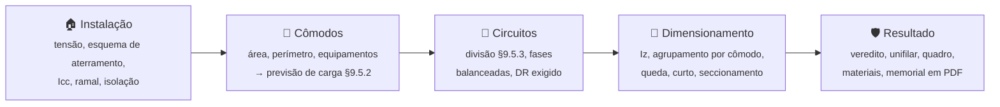

<table>
<tr>
<td width="50%"><br><sub><b>Cômodos e previsão de carga.</b> Iluminação pelo §9.5.2.1 (100 VA + 60 VA a cada 4 m² <i>inteiros</i>), tomadas pelo perímetro "ou fração" e 600 VA nas áreas molhadas.</sub></td>
<td width="50%">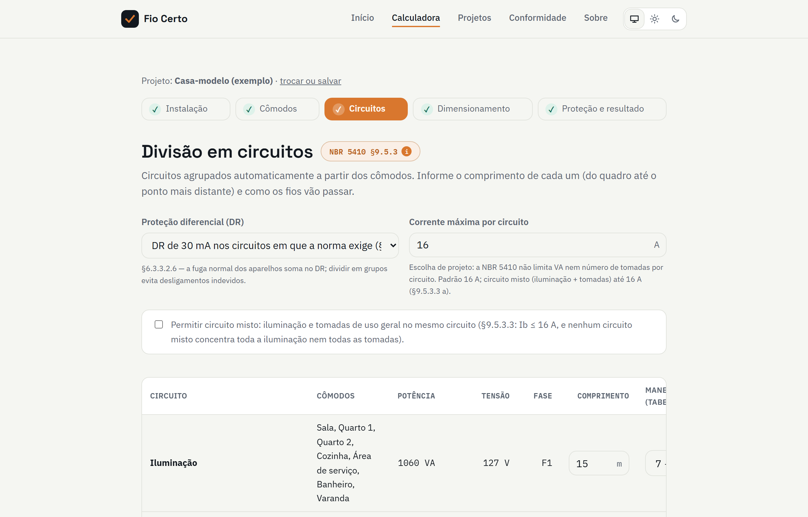<br><sub><b>Divisão em circuitos.</b> Cozinha e serviço em circuitos exclusivos, equipamento acima de 10 A em circuito próprio e fases balanceadas por busca exata (não só por heurística).</sub></td>
</tr>
<tr>
<td width="50%">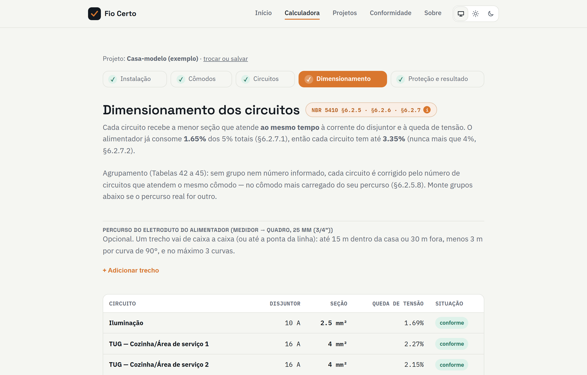<br><sub><b>Dimensionamento.</b> A seção atende ao mesmo tempo capacidade de condução, sobrecarga, curto-circuito, seccionamento e queda de tensão, que é cumulativa: o alimentador consome parte do orçamento de 5 %.</sub></td>
<td width="50%">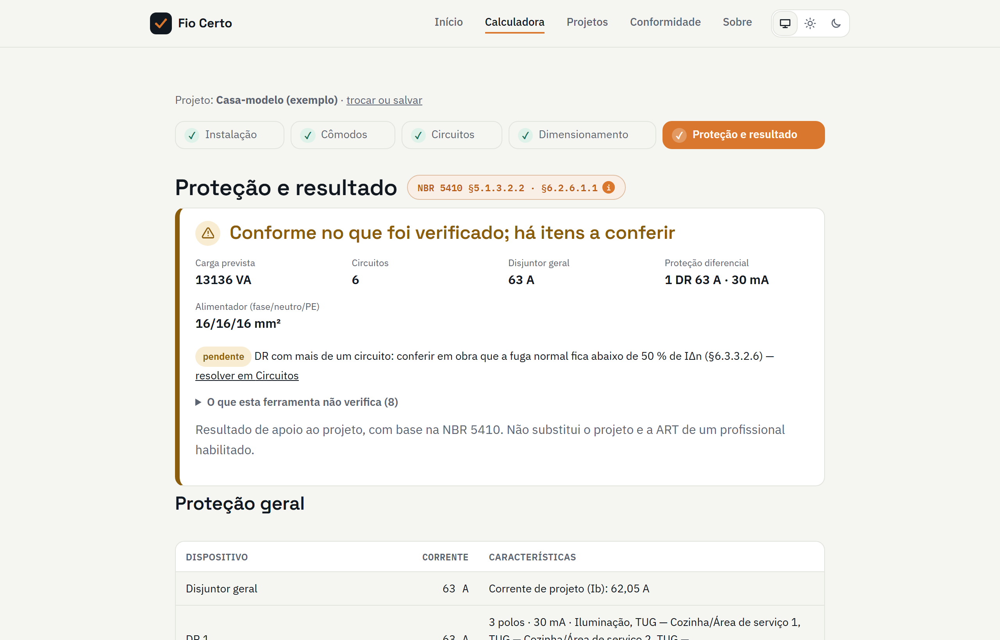<br><sub><b>Veredito.</b> Separa o que não atende à norma, o que depende de dado ou de conferência em obra e o que a ferramenta não verifica. Cada item tem link para a etapa onde se resolve.</sub></td>
</tr>
</table>

### Diagrama unifilar e quadro gerados automaticamente

<div align="center">
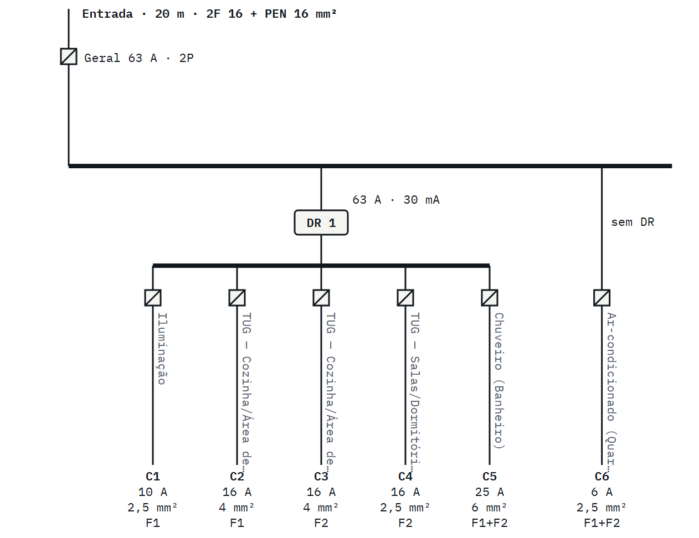
<br>
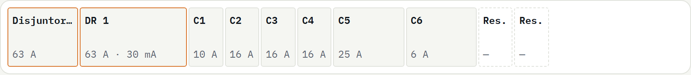
<br><sub>Disjuntor geral, DR só nos circuitos em que a norma o exige, circuitos numerados como no quadro (§6.1.5.4) e espaços de reserva da Tabela 59.</sub>
</div>

### Volumes do banheiro (§9.1.2.1), ponto a ponto

<div align="center">
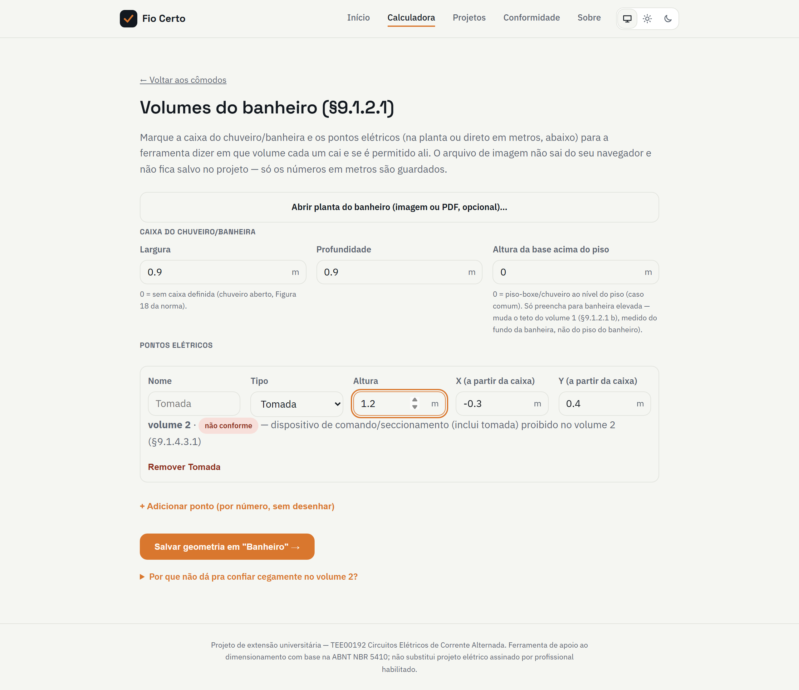
<br><sub>Marque a caixa do chuveiro e os pontos elétricos, na planta (imagem ou PDF) ou em metros. A ferramenta diz em que volume cada ponto cai e se aquele dispositivo é permitido ali.</sub>
</div>

---

## Memorial técnico pronto para assinar

Um clique gera o memorial (§6.1.8.1) para imprimir ou salvar em PDF, em A4 com páginas numeradas.
**[Veja o exemplo completo da casa-modelo (PDF, 26 páginas)](docs/modelo-relatorio/memorial-casa-modelo.pdf).**

<table>
<tr>
<td width="44%" valign="top">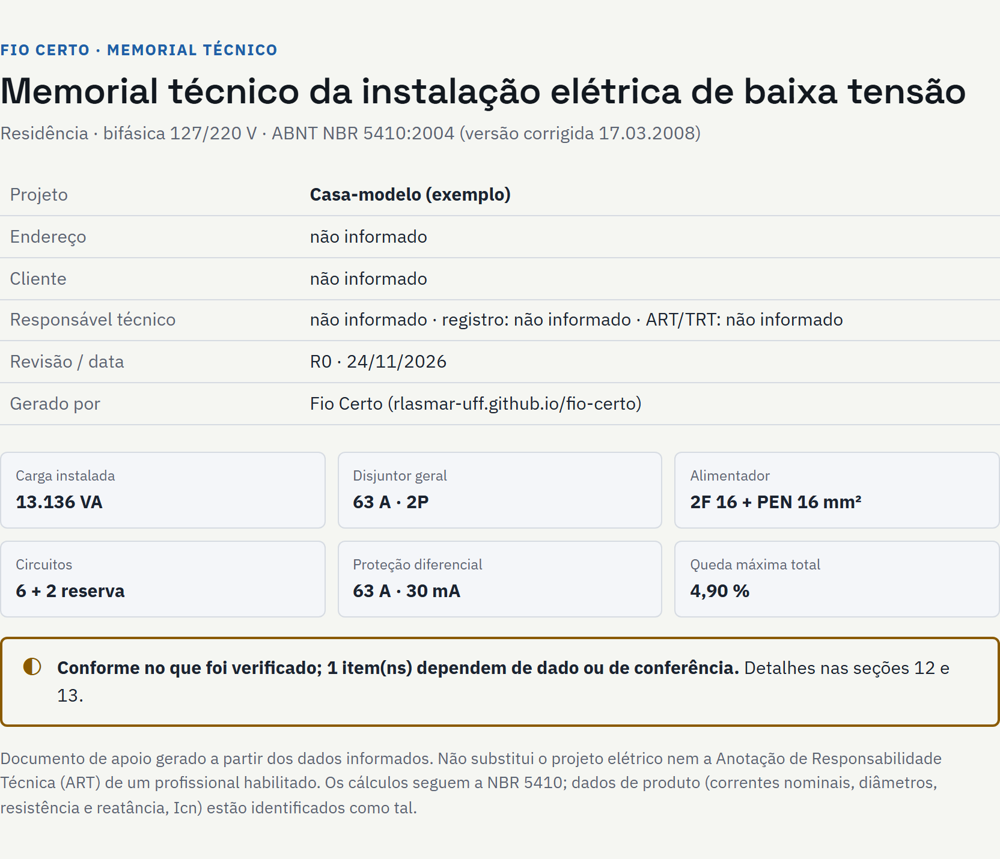<br><sub><b>Capa:</b> identificação, responsável técnico e ART, números principais e veredito.</sub></td>
<td width="56%" valign="top">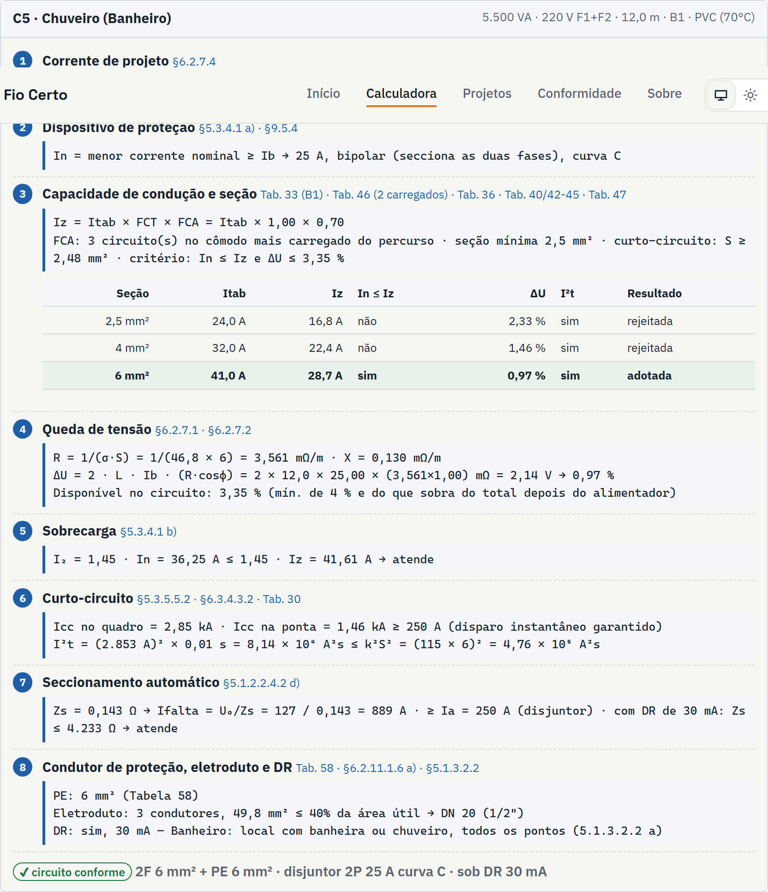<br><sub><b>Uma ficha por circuito:</b> Ib, disjuntor, Iz com FCT e FCA, seções testadas e rejeitadas, queda com R e X, sobrecarga, I²t ≤ k²S², seccionamento, PE, eletroduto e o motivo do DR.</sub></td>
</tr>
</table>

<div align="center">
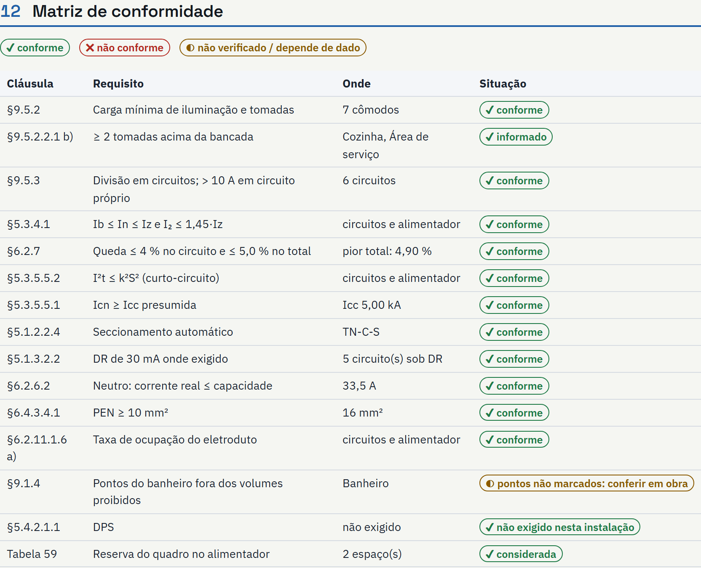
<br><sub>Matriz de conformidade: cada cláusula verificada no projeto, com ✔ conforme, ✖ não conforme ou ◐ depende de dado.</sub>
</div>

O memorial também traz premissas declaradas (fator de demanda, resistividade, fator k), previsão de carga
com a regra aplicada em cada cômodo, alimentador, proteções complementares (DR, DPS, PEN, aterramento,
equipotencialização), locais especiais, lista de materiais, pendências, checklists de verificação em
obra (Cap. 7) e referências.

---

## O que é calculado

<table>
<tr><th>Etapa</th><th>O que a NBR 5410 pede e a ferramenta faz</th></tr>
<tr><td><b>Previsão de carga</b></td><td>Iluminação e tomadas mínimas por cômodo (§9.5.2), equipamentos com cosφ e rendimento, alternativa dos 600 VA (§9.5.2.2.2) só quando o usuário escolhe</td></tr>
<tr><td><b>Circuitos</b></td><td>Separação iluminação/tomadas, circuitos exclusivos, circuito misto nas condições do §9.5.3.3, balanceamento exato de fases (mono, bi e trifásico)</td></tr>
<tr><td><b>Condutores</b></td><td>Tabelas 36 a 39 conferidas célula a célula contra o PDF; métodos A1 a G (Tabela 33); temperatura (Tab. 40), solo (Tab. 41) e <b>agrupamento por cômodo</b> (Tab. 42 a 45); condutores carregados (Tab. 46); seções mínimas (Tab. 47)</td></tr>
<tr><td><b>Queda de tensão</b></td><td>4 % no circuito e 5 % ou 7 % no total, cumulativo; resistência na temperatura de operação, reatância e cálculo fasorial por fase no alimentador, com o neutro real</td></tr>
<tr><td><b>Proteção</b></td><td>Ib ≤ In ≤ Iz e I₂ ≤ 1,45·Iz; curto-circuito I²t ≤ k²S² com a Icc propagada até a ponta de cada circuito; capacidade de interrupção; seccionamento automático TN (Zs·Ia ≤ U₀) e TT (RA·IΔn ≤ UL)</td></tr>
<tr><td><b>DR e DPS</b></td><td>DR de 30 mA onde exigido (banheiro, áreas molhadas e externas, TT, piscina), por grupo ou geral, com seletividade; DPS quando exigido (§5.4.2.1.1), com esquema de conexão 1/2/3, Uc, Up, In e Iimp</td></tr>
<tr><td><b>Neutro, PE e PEN</b></td><td>Neutro por soma fasorial com 3ª harmônica, PE pela Tabela 58 ou por cálculo, PEN ≥ 10 mm², condutor de aterramento (Tab. 52) e equipotencialização</td></tr>
<tr><td><b>Eletroduto</b></td><td>Taxa de ocupação (53/31/40 %) e percurso entre caixas, com curvas (§6.2.11.1.6 e .7)</td></tr>
<tr><td><b>Locais especiais</b></td><td>Banheiro (volumes 0 a 3, IP e dispositivos permitidos), piscina (§9.2) e sauna (§9.4)</td></tr>
<tr><td><b>Entrega</b></td><td>Unifilar, quadro com reserva, lista de materiais com folga, memorial em PDF, comparação de cenários, projetos salvos em arquivo ou link</td></tr>
</table>

O mapa completo, cláusula por cláusula e com o teste que cobre cada uma, fica na própria página
**[Conformidade](https://rlasmar-uff.github.io/fio-certo/#/conformidade)** do site.

---

## Testado como se tudo estivesse errado

Cada regra calculada tem teste automático, e os valores esperados foram calculados à mão a partir do texto
da norma, nunca de memória. Na auditoria de novembro/2026 os testes foram reescritos do zero, partindo da
hipótese de que tudo estava errado. Os achados foram corrigidos e viraram testes de regressão.

| Camada | O que roda | Resultado |
|---|---|---|
| **Harness de conformidade** (`QA/scripts/verificar.mjs`) | 46 grupos de verificação (G1 a G47) por tema da norma, cada critério com cláusula, evidência numérica e severidade | **351 conformes · 0 divergências** |
| **Auditoria independente** (`QA/auditoria-independente/`) | Escrita sem olhar o harness: tabelas contra o PDF por coordenadas e contas manuais | **59 / 59** |
| **Ponta a ponta** (Playwright) | Fluxos reais no navegador: exemplo, projetos, planta, banheiro, memorial, modo offline | **107 testes** em Chrome, Firefox e Safari (WebKit) |
| **CI** (GitHub Actions) | Lint, build, harness e Playwright a cada push; só publica se tudo passar | ver o selo acima |

Também foi feita uma conferência bibliográfica contra o Creder (*Instalações Elétricas*, 16ª ed.). Os
relatórios estão em [`QA/relatorios/`](QA/relatorios) e
[`docs/PLANO_DE_CORRECAO_2026-11.md`](docs/PLANO_DE_CORRECAO_2026-11.md).

---

## Em qualquer tela, de dia ou de noite

<table>
<tr>
<td width="70%"></td>
<td width="30%">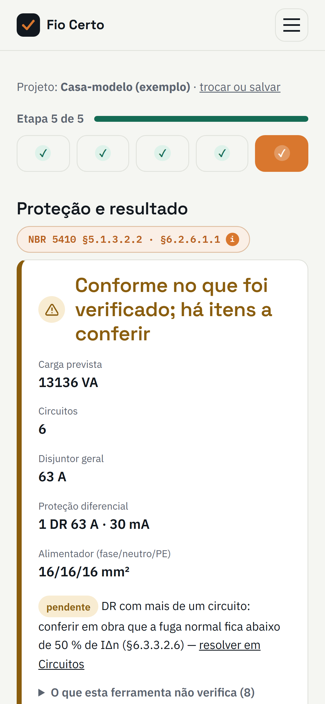</td>
</tr>
<tr><td><sub>Tema escuro automático ou escolhido.</sub></td><td><sub>Responsivo, instalável como app (PWA) e funciona sem internet.</sub></td></tr>
</table>

---

## Rodando localmente

Requer Node.js 24+.

```bash
cd frontend
npm install
npm run dev       # servidor de desenvolvimento
npm run build     # build de produção em frontend/dist
npm run lint      # oxlint
npm test          # harness de conformidade NBR 5410
npm run e2e       # testes de ponta a ponta (Playwright)
```

## Estrutura do repositório

```
frontend/
  src/calculations/   motor de cálculo puro (sem React): cada arquivo cita as cláusulas que implementa
  src/pages/          etapas da calculadora, resultado e memorial
  e2e/                testes Playwright
QA/
  scripts/            harness de conformidade (npm test)
  auditoria-independente/  testes escritos do zero contra o texto da norma
  referencias/        valores normativos conferidos, matriz de conformidade, casos de teste
  relatorios/         auditorias
docs/                 plano de correção, modelo do memorial, relatório técnico e seminário
```

## Stack

React + Vite, roteamento 100 % client-side (`HashRouter`) e toda a lógica no navegador, sem backend. Os
projetos ficam no `localStorage` e podem ser exportados em arquivo ou compartilhados por link. Publicação
automática no GitHub Pages pelo GitHub Actions.

Escopo detalhado em [ESCOPO.md](ESCOPO.md). O que ainda falta está em [FUTURO.md](FUTURO.md) e
[PENDENCIAS.md](PENDENCIAS.md).

## Aviso sobre a norma

O exemplar da NBR 5410 usado como referência técnica é licenciado para uso exclusivo do comprador e
**não** é redistribuído neste repositório. Só os critérios técnicos (tabelas, fórmulas e limites) foram
implementados no código, sempre com a cláusula de origem.
